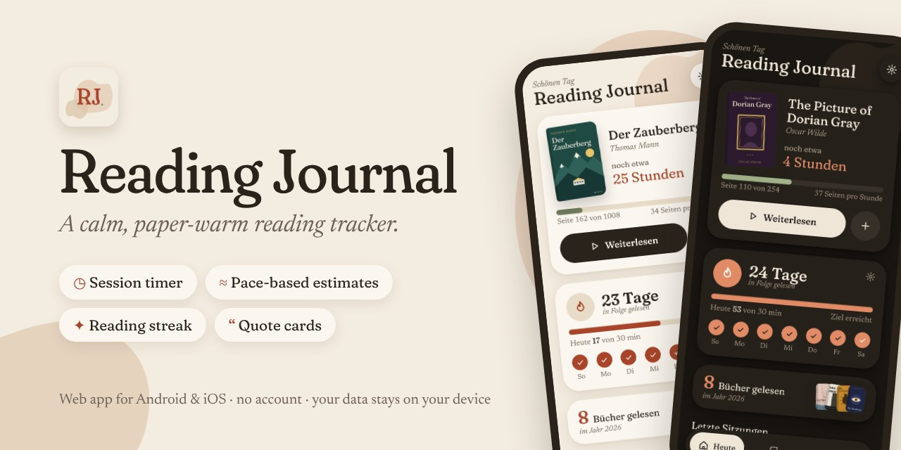
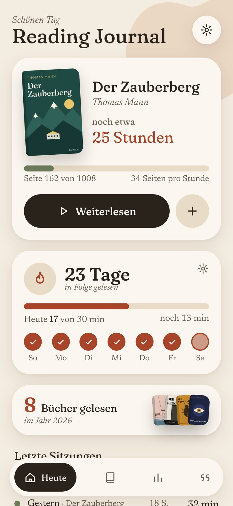
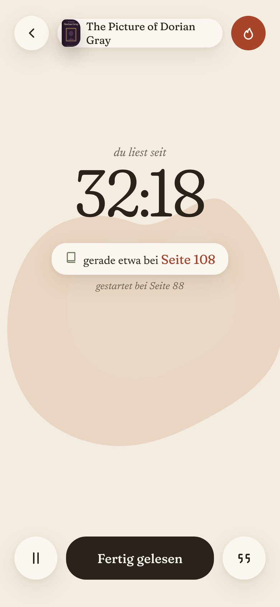
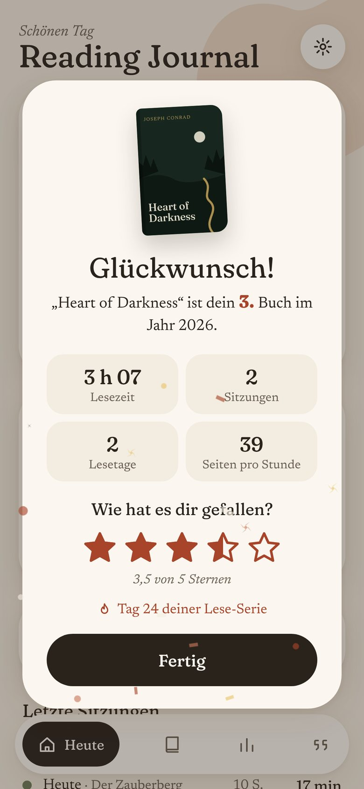
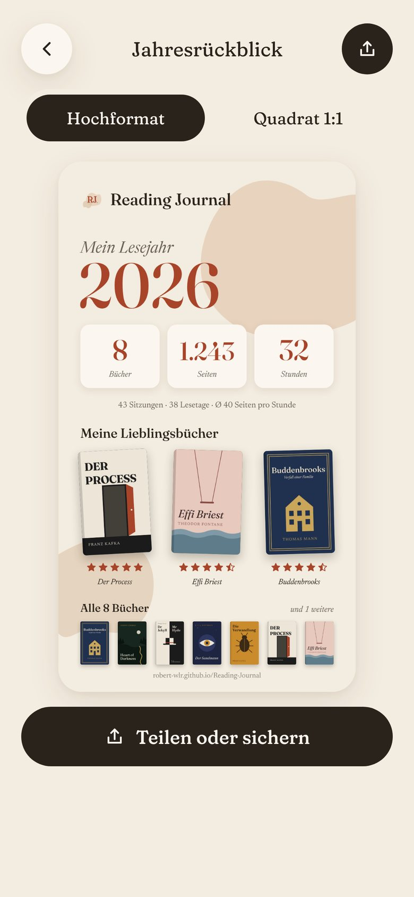

# Reading Journal

**A calm, paper-warm reading tracker.** Time your sessions or log pages and let your personal pace fill in the rest. Build a gentle daily streak, scan books by ISBN, design quote cards in beautiful fonts and read to soft fire, drizzle or white noise. No account, no ads – your data stays on your device.

**[Open the app](https://robert-wlr.github.io/Reading-Journal/)** · **[About / Vorstellung](https://robert-wlr.github.io/Reading-Journal/about.html)**

## Features

- **Session timer** – keeps running in the background and shows roughly which page you should be on
- **Pace-based estimates**
  - Enter the page and the app estimates your reading time; adjust it with the pencil if needed.
  - Enter only the time (e.g. from an e-reader) and the app works out the matching page in your printed copy.
- **Reading streak** – daily goal in minutes or pages, and a celebration screen that grows with your streak
- **Books** – add them by barcode scan, ISBN or title search (Open Library and Google Books); everything stays editable
- **Quote cards**
  - scan a book page with your camera; the text is recognised on your device (OCR)
  - 13 typefaces, adjustable weight, italic or upright
  - five colours, three formats
  - share as an image
- **Ratings & year in review**
  - rate finished books with half stars
  - share your reading year as an image (story or square)
- **Focus sounds** – campfire, drizzle and warm white noise, generated live
- **Night mode, statistics and backups** – export to Google Drive or iCloud

| | | | |
|---|---|---|---|
|  |  |  |  |

## Install

Open the app link, then:

- **Android (Chrome):** menu ⋮ → *Install app* / *Add to home screen*
- **iPhone (Safari):** Share → *Add to Home Screen*

## Privacy

There is no server, account or tracking. All data is stored in your browser on your device (IndexedDB).
